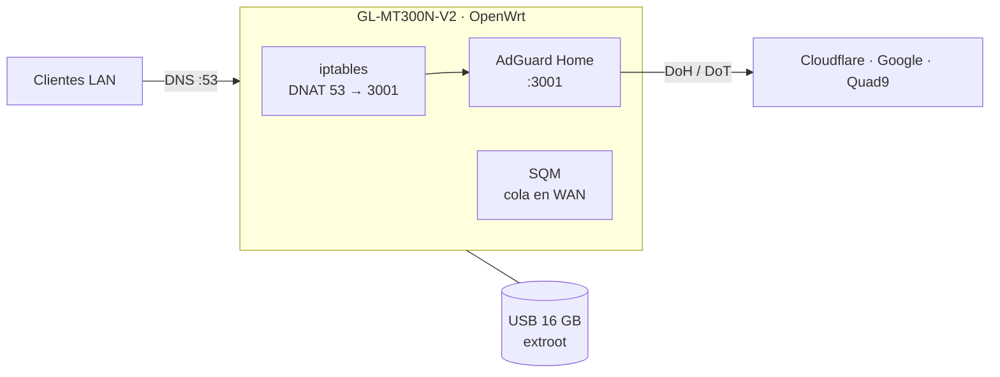

# Mini-Homelab

Pasarela de red portátil y de bajo coste sobre un router de viaje GL.iNet: bloqueo de publicidad y rastreadores con AdGuard Home, DNS cifrado hacia el exterior, control de colas con SQM para reducir el *bufferbloat* y estadísticas de uso. Fue mi primer homelab.



## Hardware

| Componente | Detalle |
|---|---|
| Router | GL.iNet GL-MT300N-V2 (Mango) |
| Almacenamiento | Memoria USB de 16 GB, ext4, como overlay (extroot) |
| Alimentación | 5 V / 2 A micro-USB |

El router solo tiene 16 MB de flash, insuficiente para AdGuard Home. El extroot traslada el overlay de OpenWrt a la memoria USB.

## 1. Acceso inicial

Con el PC conectado al puerto LAN, el asistente está en `http://192.168.8.1`: idioma y contraseña de administración. El resto se hace por SSH y LuCI.

## 2. Extroot

Paquetes necesarios para montar la memoria USB:

```bash
opkg update
opkg install block-mount kmod-usb-storage kmod-fs-ext4 e2fsprogs
```

Formateo y montaje como overlay:

```bash
block info                 # identificar la memoria, normalmente /dev/sda1
mkfs.ext4 /dev/sda1
```

En *LuCI → Sistema → Puntos de montaje* se asigna `/dev/sda1` como overlay externo y se reinicia.

```bash
df -h                      # /overlay debe aparecer sobre /dev/sda1
```

## 3. Servicios

```bash
opkg update
opkg install adguardhome luci-app-sqm luci-app-statistics
```

### SQM

*LuCI → Red → SQM QoS*, sobre la interfaz WAN (`eth0`), con velocidades de bajada y subida al 90 % de las reales. Al dejar un margen, la cola se gestiona en el router y no en el módem del operador, lo que evita los picos de latencia con la línea saturada.

### AdGuard Home

Asistente en `http://192.168.8.1:3000`:

| Parámetro | Valor | Motivo |
|---|---|---|
| Interfaz web | 3000 | |
| Servidor DNS | 3001 | El 53 lo ocupa dnsmasq |

**Upstreams cifrados**, dos por DNS sobre HTTPS (DoH) y uno por DNS sobre TLS (DoT):

```
https://dns.cloudflare.com/dns-query
https://dns.google/dns-query
tls://dns.quad9.net
```

**Listas de bloqueo:** AdGuard DNS Filter y EasyList.

## 4. Redirección de DNS

Para que todas las consultas de la LAN pasen por AdGuard aunque un cliente tenga otro DNS configurado:

1. *Panel de GL.iNet → Red → DNS*: activar *Override DNS Settings for All Clients*.
2. Redirigir el puerto 53 hacia AdGuard, en `/etc/firewall.user` o en las reglas personalizadas de LuCI para que persista:

```bash
iptables -t nat -A PREROUTING -i br-lan -p udp --dport 53 -j DNAT --to 192.168.8.1:3001
iptables -t nat -A PREROUTING -i br-lan -p tcp --dport 53 -j DNAT --to 192.168.8.1:3001
```

## 5. LED

Tras el extroot el sistema puede reasignar las rutas de los LED. Se comprueban los disponibles y se asigna un *trigger* de actividad:

```bash
ls /sys/class/leds/
cat /sys/class/leds/red:wlan/trigger      # triggers disponibles
echo mmc0 > /sys/class/leds/red:wlan/trigger
```

## Verificación

```bash
netstat -tulpn | grep -i adguard       # 3000 y 3001 en escucha
df -h                                  # /overlay sobre /dev/sda1
nslookup doubleclick.net 192.168.8.1   # dominio de publicidad: debe devolver 0.0.0.0
```

En el panel de AdGuard, el contador de consultas debe subir al navegar desde cualquier cliente.

## Incidencias

| Síntoma | Causa | Solución |
|---|---|---|
| La publicidad sigue apareciendo tras activar filtros | Caché del navegador | Probar en ventana privada |
| AdGuard no arranca tras reiniciar | La memoria USB se monta después de que el servicio intente iniciarse | `/etc/init.d/adguardhome restart` |
